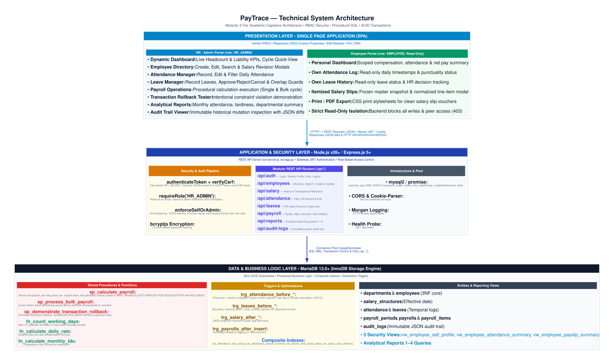
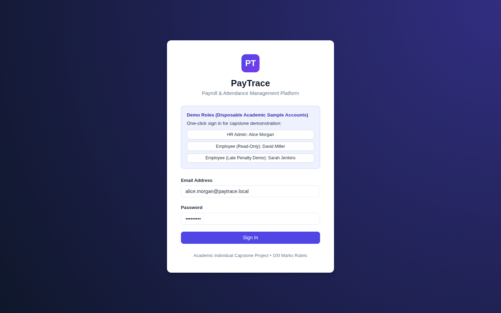
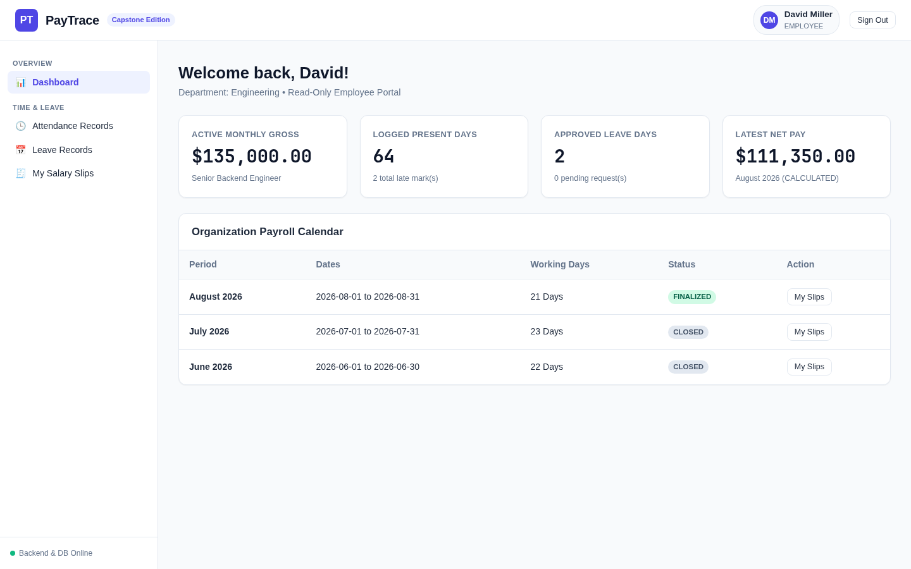
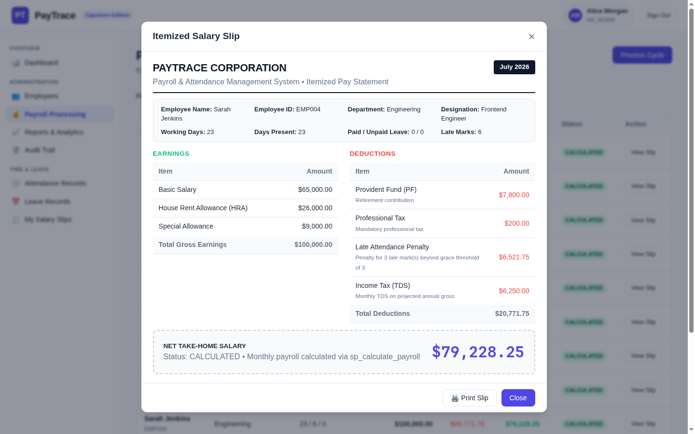
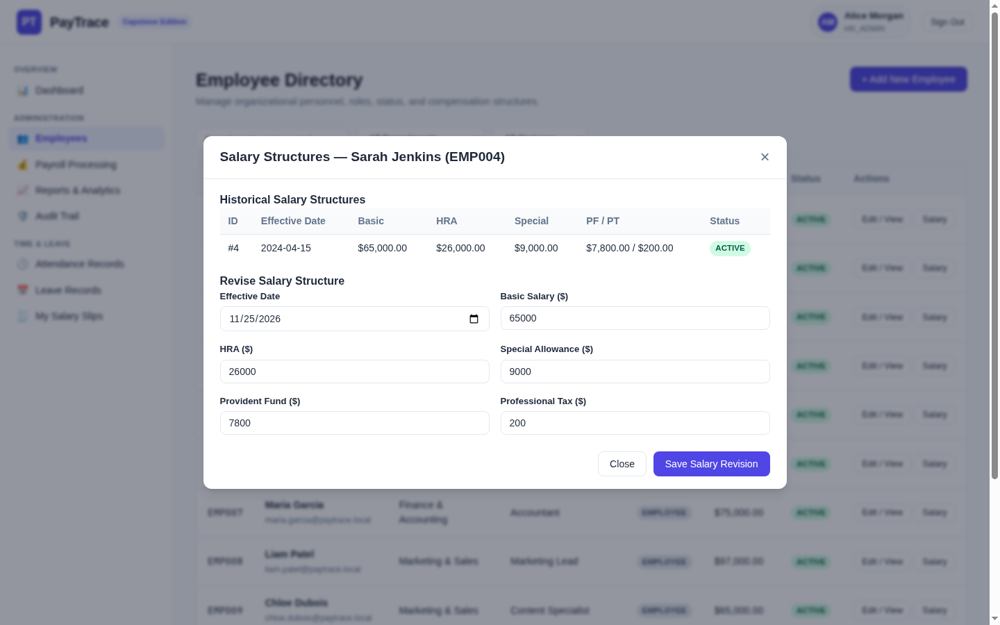
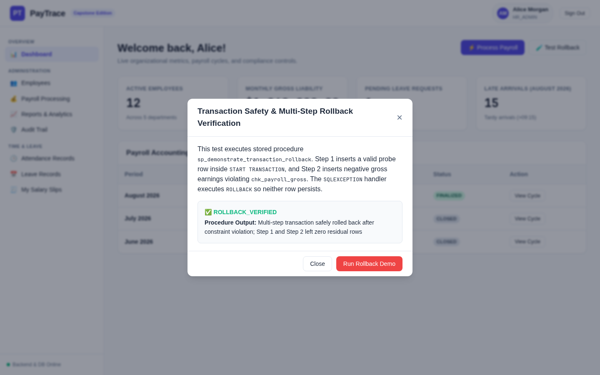

# PayTrace — Payroll & Attendance Management System

**Academic Capstone Project (100-Mark Five-Phase Rubric)**  
**Author:** Pulkit Pradhan (`2501730036`)  
**Tech Stack:** MariaDB 13.0.2 (InnoDB) · Node.js / Express 5 · Vanilla HTML5 / CSS3 / ES6 SPA

PayTrace is a complete, database-centric Payroll & Attendance Management System engineered sequentially across five connected academic phases: 3NF relational schema design, stored procedural payroll computation and trigger enforcement, indexed SQL reporting, defense-in-depth RBAC/CSRF/transaction verification, and a clean role-scoped web portal.

---

## System Architecture



*High-resolution diagram: [system-architecture.png](docs/assets/diagrams/system-architecture.png)*

---

## Key Verified Capabilities

- **Frozen 9-Table 3NF Relational Schema (`database/schema.sql`):** `departments`, `employees`, `salary_structures`, `attendance`, `leaves`, `payroll_periods`, `payrolls`, `payroll_items`, and `audit_logs` with PKs, FKs, composite unique keys (`uq_emp_work_date`, `uq_emp_payroll_period`), and `CHECK` constraints.
- **Database-Driven Procedural Payroll (`database/functions.sql`, `triggers.sql`, `procedures.sql`):**
  - `fn_count_working_days`: Mon–Fri working calendar (`June 2026 = 22d`, `July 2026 = 23d`, `August 2026 = 21d`).
  - `sp_calculate_payroll` & `sp_process_bulk_payroll`: Effective-dated salary lookup (`effective_date <= period.end_date`), cross-month leave proration, `HALF_DAY` (`0.5`) handling, tardiness penalty (`> 09:15:00`, >3 monthly late marks deduct `0.5` day each), progressive monthly TDS (`fn_calculate_monthly_tds`), and deduction capping (`net_salary >= 0.00`).
  - Validation triggers rejecting invalid clock-out orders, non-worked timestamps, server-mismatched leave durations, and overlapping `APPROVED` leaves on both `INSERT` and `UPDATE`.
- **Indexed Phase 3 Reports (`database/indexes.sql`, `database/reports.sql`):**
  - Report 1: Monthly Attendance Summary (`HALF_DAY` weighted, inactive historical employee inclusion).
  - Report 2: Itemized Employee Salary Slip (`payroll_items` audit reconciliation).
  - Report 3: Employee Late-Marks Report backed by `idx_attendance_late_lookup (is_late, work_date)` (`93.5%` optimizer cost reduction on 792 rows; `99.3%` cost reduction / `11.9x` faster median query latency at 50k rows).
  - Report 4: Departmental Payroll Expenditure Summary.
- **Defense-in-Depth Security (`database/security.sql`, `src/middleware/auth.js`):**
  - Runtime DB account `paytrace_app` (DML + `EXECUTE` only; no `DELETE`/`DDL`) and view-only `paytrace_reader`.
  - Fail-closed `JWT_SECRET` validation, `HS256` tokens inside `HttpOnly; SameSite=Lax` cookies, double-submit `verifyCsrf`, parameterized SQL (`multipleStatements: false`), and strict horizontal/vertical RBAC making `EMPLOYEE` accounts **read-only**.
- **Comprehensive Automated Suite (`npm run test:all`):** **21 / 21** SQL/Unit/HTTP tests + **11 / 11** live headless Chromium E2E tests (`0` page/console errors).

---

## Five-Phase Academic Deliverables

| Phase | Topic & Marks | Primary Artifacts | Documentation |
| :---: | :--- | :--- | :--- |
| **Phase 1** | Data Modeling & 3NF Design (20 Marks) | [`schema.sql`](database/schema.sql), [`er-diagram.svg`](docs/assets/diagrams/er-diagram.svg) | [`schema-design.md`](docs/phase-1/schema-design.md), [`normalization.md`](docs/phase-1/normalization.md), [`er-diagram.md`](docs/phase-1/er-diagram.md) |
| **Phase 2** | Procedural Logic & Sample Data (20 Marks) | [`functions.sql`](database/functions.sql), [`triggers.sql`](database/triggers.sql), [`procedures.sql`](database/procedures.sql), [`seed.sql`](database/seed.sql), [`payroll-transaction-workflow.svg`](docs/assets/diagrams/payroll-transaction-workflow.svg) | [`procedural-implementation.md`](docs/phase-2/procedural-implementation.md), [`sample-data.md`](docs/phase-2/sample-data.md) |
| **Phase 3** | Reports & Indexing Optimization (20 Marks) | [`indexes.sql`](database/indexes.sql), [`reports.sql`](database/reports.sql) | [`report-specifications.md`](docs/phase-3/report-specifications.md), [`query-optimization.md`](docs/phase-3/query-optimization.md) |
| **Phase 4** | RBAC, Transactions & Testing (20 Marks) | [`security.sql`](database/security.sql), [`auth.js`](src/middleware/auth.js), [`test_suite.js`](tests/test_suite.js) | [`security-model.md`](docs/phase-4/security-model.md), [`test-plan.md`](docs/phase-4/test-plan.md), [`test-results.md`](docs/phase-4/test-results.md) |
| **Phase 5** | Full-Stack UI, Report & Viva (20 Marks) | [`src/app.js`](src/app.js), [`src/public/index.html`](src/public/index.html), [`browser_e2e.test.js`](tests/browser_e2e.test.js), [`PayTrace_Project_Report.pdf`](docs/report/PayTrace_Project_Report.pdf) | [`application-guide.md`](docs/phase-5/application-guide.md), [`demo-script.md`](docs/phase-5/demo-script.md), [`viva-guide.md`](docs/phase-5/viva-guide.md), [`limitations-and-future-work.md`](docs/phase-5/limitations-and-future-work.md) |

---

## Visual Walkthrough

| Login & Role Switcher | HR Executive Dashboard | Employee Read-Only Dashboard |
| :---: | :---: | :---: |
|  |  |  |

| Itemized Salary Slip (`EMP004` Jul 2026) | Salary Revision History | Multi-Step Transaction Rollback |
| :---: | :---: | :---: |
|  |  |  |

---

## Setup & Execution

### 1. Prerequisites
- Node.js `v18+` (`v26.13.0` verified)
- MariaDB Server `13.0+`

### 2. Provision Database (7-Step Idempotent Setup)
`database/setup.sql` sources schema, functions, triggers, procedures, indexes, least-privilege views/roles (`paytrace_app` & `paytrace_reader`), and the 3-month sample dataset (`12` employees, `792` attendance rows, `10` leaves, `36` payrolls, `221` items):
```bash
cp .env.example .env
# Edit .env: configure a unique 32+ char JWT_SECRET and DB credentials
mysql -u root < database/setup.sql
```

### 3. Run the Application
```bash
npm install
npm start
# Open http://127.0.0.1:3000
```

Demo Accounts:
- **HR Admin (`HR_ADMIN`):** `alice.morgan@paytrace.local` / `Admin123!`
- **Employee (`EMPLOYEE`, Read-Only):** `david.miller@paytrace.local` / `Employee123!`

### 4. Run Automated Verification
```bash
npm run test:all
# Runs tests/test_suite.js (21 tests) + tests/browser_e2e.test.js (11 Chromium E2E tests)
```

---

## Repository Structure

```text
PayTrace/
├── database/
│   ├── schema.sql              # Frozen 9-table 3NF DDL
│   ├── functions.sql           # fn_count_working_days, fn_calculate_daily_rate, fn_calculate_monthly_tds
│   ├── triggers.sql            # Attendance, Leave overlap/duration, Salary & Payroll audit triggers
│   ├── procedures.sql          # sp_calculate_payroll, sp_process_bulk_payroll, sp_demonstrate_transaction_rollback
│   ├── indexes.sql             # 4 composite Phase 3 performance indexes
│   ├── security.sql            # 3 views, 2 roles, paytrace_app & paytrace_reader grants
│   ├── reports.sql             # Verified Phase 3 SQL report definitions
│   ├── generate_seed.js        # Deterministic Mon-Fri 3-month dataset generator
│   ├── seed.sql                # Sample dataset + initial computed payrolls
│   └── setup.sql               # 7-step master provisioning script
├── src/
│   ├── config/db.js            # mysql2/promise pool (dateStrings, multipleStatements: false)
│   ├── middleware/auth.js      # JWT cookie/Bearer, timingSafe CSRF, RBAC & self/admin guards
│   ├── utils/validators.js     # Input bounds, ISO date, Mon-Fri weekday helpers
│   ├── routes/                 # auth, employee, salary, attendance, leave, payroll, report, audit
│   ├── public/                 # Vanilla HTML5/CSS3/ES6 SPA
│   ├── app.js & server.js      # Express 5 application & fail-closed startup
├── tests/
│   ├── test_suite.js           # 21 SQL, Unit & HTTP tests
│   └── browser_e2e.test.js     # 11 Chromium CDP E2E tests
└── docs/
    ├── phase-1/ ... phase-5/   # Phase deliverables, viva guide, demo script
    ├── assets/                 # 3 diagram sets + 14 live 1440x900 screenshots
    └── report/                 # PayTrace_Project_Report.{md,html,pdf} & generate_pdf.js
```
