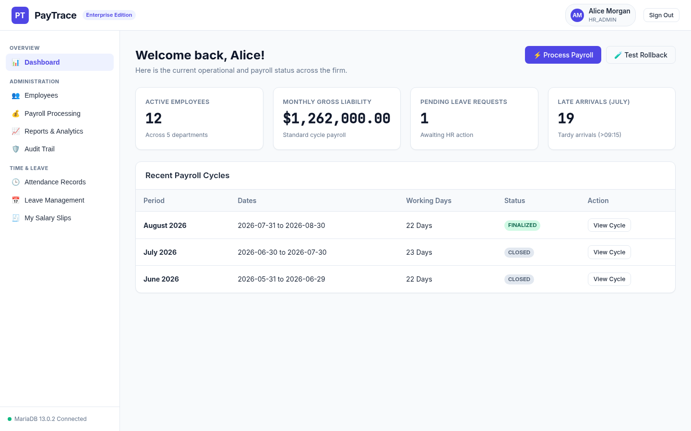

# PayTrace — Payroll & Attendance Management System

[](https://nodejs.org/)
[](https://mariadb.org/)
[](tests/test_suite.js)
[](#academic-phase-structure)

**PayTrace** is a transparent, auditable, and transaction-safe Payroll & Attendance Management System built as an individual academic capstone project. It demonstrates relational schema modeling (3NF/BCNF), procedural SQL calculations, query optimization, role-based security isolation, transaction safety (COMMIT / ROLLBACK), and full-stack web integration.

---

## Key Features

1. **Explainable Salary Calculations:** Itemized breakdown of gross earnings, house rent allowance, special allowances, statutory provident fund, professional tax, unpaid leave deductions, tardiness penalties, and progressive TDS income tax.
2. **Attendance & Leave Temporal Guardrails:** Database constraints and triggers preventing duplicate daily attendance and overlapping approved leave requests.
3. **Transaction Safety:** ACID-compliant payroll processing with explicit error catching and verified ROLLBACK on constraint failure.
4. **Historical Snapshot Preservation:** Finalized payroll records preserve immutable snapshots so future compensation revisions never alter past payslips.
5. **Role-Based Data Isolation:** Server-side identity resolution guarantees that employees can access only their own authorized attendance, leave, and salary records.

---

## Academic Phase Structure (100 Marks Total)

| Phase | Title | Marks | Key Deliverables | Status |
| :---: | :--- | :---: | :--- | :---: |
| **Phase 1** | Data Modeling & Schema Design | 20 | 9 Normalized Tables, 3NF Proof, ER Diagram, SQL DDL | **Completed & Verified** |
| **Phase 2** | Procedural Implementation | 20 | Stored Functions, Procedures, Triggers, 12 Emps / 3 Months Seed | **Completed & Verified** |
| **Phase 3** | Query & Report Development | 20 | Attendance Summary, Salary Slips, Late-Marks Report, Index Optimization | **Completed & Verified** |
| **Phase 4** | Security, RBAC & Testing | 20 | RBAC Matrix, 20/20 Passing Automated Tests, Transaction Rollback Demo | **Completed & Verified** |
| **Phase 5** | Full-Stack Integration & UI | 20 | Connected Web Interface, Demo Script, Architecture & Scalability Guides | **Completed & Verified** |

---

## Repository Structure

```text
PayTrace/
├── README.md
├── .env.example
├── .gitignore
├── package.json
├── database/
│   ├── schema.sql              # Approved Phase 1 DDL schema (9 normalized tables)
│   ├── functions.sql           # Stored functions (daily rate, progressive TDS)
│   ├── triggers.sql            # Validation & audit triggers (leave overlap, attendance)
│   ├── procedures.sql          # Stored procedures (sp_calculate_payroll, rollback test)
│   ├── seed.sql                # Realistic seed: 12 employees across 3 months (792 rows)
│   ├── indexes.sql             # Composite performance optimization indexes
│   ├── reports.sql             # Mandatory reports (Attendance, Slips, Late Marks)
│   └── setup.sql               # Master idempotent database provisioning script
├── src/
│   ├── app.js                  # Express application configuration
│   ├── server.js               # Web server entry point
│   ├── config/
│   │   └── db.js               # MariaDB / MySQL connection pool
│   ├── middleware/
│   │   └── auth.js             # JWT authentication & RBAC self-or-admin middleware
│   ├── routes/
│   │   ├── authRoutes.js       # Login, logout, session verification
│   │   ├── employeeRoutes.js   # Employee roster & creation
│   │   ├── attendanceRoutes.js # Clock-in & attendance query endpoints
│   │   ├── leaveRoutes.js      # Leave application & approval workflow
│   │   ├── payrollRoutes.js    # Payroll calculation & itemized slips
│   │   ├── salaryRoutes.js     # Salary structure revisions
│   │   ├── reportRoutes.js     # Reports endpoints (Phase 3)
│   │   └── auditRoutes.js      # Immutable audit trail
│   └── public/
│       ├── index.html          # Role-based Single Page Application
│       ├── css/style.css       # Enterprise styling & print layout
│       └── js/app.js           # Frontend client controller
├── tests/
│   └── test_suite.js           # Automated suite executing all 20 mandatory test cases
└── docs/
    ├── phase-1/                # Schema design, ER diagram (Mermaid), Normalization proof
    ├── phase-2/                # Procedural implementation & sample dataset specs
    ├── phase-3/                # Report specifications & before/after EXPLAIN plans
    ├── phase-4/                # Security model, test plan, and test results matrix
    └── phase-5/                # Application guide, demo script, scalability & limitations
```

---

## Quick Start & Setup Guide

### 1. Prerequisites
- **Node.js:** v18.0.0 or higher (v26 installed)
- **Database Engine:** MariaDB 10.5+ / 13.0+ or MySQL 8.0+ running on port 3306

### 2. Environment Configuration
Copy `.env.example` to `.env`:
```bash
cp .env.example .env
```
Default parameters in `.env`:
```ini
PORT=3000
NODE_ENV=development
DB_HOST=127.0.0.1
DB_PORT=3306
DB_USER=root
DB_PASSWORD=
DB_NAME=paytrace_db
JWT_SECRET=supersecret_paytrace_academic_jwt_key_2026_secure
```

### 3. Database Initialization & Environment Safety

> [!WARNING]
> **Destructive Reset vs. Safe Provisioning:**
> `database/setup.sql` sources `database/schema.sql` (which includes `DROP TABLE IF EXISTS`) and `database/seed.sql` (which truncates and repopulates demo records). Running `setup.sql` **destroys all existing tables and reinitializes the database from scratch**.
> - **Initial Fresh Setup / Demo Reset:** Run the command below only when first setting up the project or when explicitly resetting the demo environment to its clean baseline state.
> - **Active / Production Environments:** Never run `setup.sql` or `schema.sql` against a live or user-populated database. To preserve existing data without dropping tables, execute migration DDLs or inspect schema definitions individually.

Execute the master provisioning script against your database server:
```bash
mariadb -u root -h 127.0.0.1 < database/setup.sql
```
*This command provisions the database, tables, functions, triggers, procedures, indexes, and populates 12 employees across 3 complete months (792 attendance records and 36 finalized payroll statements).*

### 4. Install Dependencies
```bash
npm install
```

### 5. Run Automated Tests
Execute the 20 mandatory test cases covering constraints, transactions, formulas, and RBAC:
```bash
npm test
```
*Expected Output: `TEST EXECUTION SUMMARY: 20 / 20 PASSED`.*

### 6. Start the Web Application
```bash
npm start
```
Open your browser at: **`http://localhost:3000`**

---

## Demo Accounts & Role Verification

The login screen features one-click demo role buttons:

| Role | Name | Email | Password | Allowed Capabilities |
| :--- | :--- | :--- | :--- | :--- |
| **HR / Admin** | Alice Morgan | `alice.morgan@paytrace.local` | `Admin123!` | Full roster management, execute payroll cycles, approve leaves, generate analytical reports, view audit logs, test transaction rollback. |
| **Staff Employee** | David Miller | `david.miller@paytrace.local` | `Employee123!` | Self-service dashboard, daily clock-in, submit leave requests, view own attendance, view own itemized salary slips. |
| **Tardiness Demo** | Sarah Jenkins | `sarah.jenkins@paytrace.local` | `Employee123!` | Demonstrates late penalty deduction in July 2026 (6 late marks incurring a 3-half-day salary penalty). |

---

## Visual Interface & Architecture Deliverables

### System Architecture


*Technical Diagram Downloads:*
- **Entity-Relationship Model:** [[Vector SVG](docs/assets/diagrams/er-diagram.svg)] • [[High-DPI PNG (4948 × 3657 px)](docs/assets/diagrams/er-diagram.png)] • [[Graphviz DOT](docs/assets/diagrams/er-diagram.dot)] • [[Mermaid](docs/assets/diagrams/er-diagram.mermaid)]
- **System Architecture:** [[Vector SVG](docs/assets/diagrams/system-architecture.svg)] • [[High-DPI PNG (3927 × 3218 px)](docs/assets/diagrams/system-architecture.png)] • [[Graphviz DOT](docs/assets/diagrams/system-architecture.dot)] • [[Mermaid](docs/assets/diagrams/system-architecture.mermaid)]
- **Payroll & Transaction Workflow:** [[Vector SVG](docs/assets/diagrams/payroll-transaction-workflow.svg)] • [[High-DPI PNG (3397 × 6372 px)](docs/assets/diagrams/payroll-transaction-workflow.png)] • [[Graphviz DOT](docs/assets/diagrams/payroll-transaction-workflow.dot)] • [[Mermaid](docs/assets/diagrams/payroll-transaction-workflow.mermaid)]

### Core UI Gallery
| View | Description | Screenshot Preview |
| :--- | :--- | :--- |
| **HR / Admin Dashboard** | Real-time aggregate metrics, liability tracking, and cycle management |  |
| **Itemized Salary Slip** | Sarah Jenkins July 2026 slip with 6 late marks and $6,521.75 penalty |  |
| **RBAC Security Enforcement** | Direct object access / tampering blocked with HTTP 403 alert |  |

<details>
<summary><strong>Click to expand the complete 11-screen UI capture index</strong></summary>

| # | Screen Name | Path | Description |
|---|---|---|---|
| 01 | Login Screen | [`01-login.png`](docs/assets/screenshots/01-login.png) | Authentication portal with 1-click evaluation shortcuts |
| 02 | HR Dashboard | [`02-hr-dashboard.png`](docs/assets/screenshots/02-hr-dashboard.png) | High-level organizational KPI metrics and quick actions |
| 03 | Employee Dashboard | [`03-employee-dashboard.png`](docs/assets/screenshots/03-employee-dashboard.png) | Self-service compensation overview and punch clock |
| 04 | Employee Roster | [`04-employee-roster.png`](docs/assets/screenshots/04-employee-roster.png) | 12-employee directory across 5 departments |
| 05 | Attendance Log | [`05-attendance-management.png`](docs/assets/screenshots/05-attendance-management.png) | August 2026 daily check-in log and punctuality badges |
| 06 | Leave Workflow | [`06-leave-workflow.png`](docs/assets/screenshots/06-leave-workflow.png) | Leave application modal and HR approval/rejection queue |
| 07 | Payroll Cycle | [`07-payroll-processing.png`](docs/assets/screenshots/07-payroll-processing.png) | July 2026 cycle calculation and status monitoring |
| 08 | Itemized Salary Slip | [`08-itemized-salary-slip.png`](docs/assets/screenshots/08-itemized-salary-slip.png) | Itemized earnings, statutory deductions, and net pay voucher |
| 09 | Attendance Report | [`09-monthly-attendance-report.png`](docs/assets/screenshots/09-monthly-attendance-report.png) | Phase 3 monthly attendance analytical summary |
| 10 | Late-Marks Report | [`10-late-marks-report.png`](docs/assets/screenshots/10-late-marks-report.png) | Phase 3 analytical ranking of tardy arrivals (>09:15) |
| 11 | Access Denied | [`11-access-denied-behavior.png`](docs/assets/screenshots/11-access-denied-behavior.png) | Client & server RBAC 403 Forbidden protection against snooping |

</details>

---

## Evaluation Evidence Highlights

- **Normalization Proof:** Documented in [normalization.md](docs/phase-1/normalization.md) (All relations satisfy 3NF & BCNF).
- **Execution Optimization:** Documented in [query-optimization.md](docs/phase-3/query-optimization.md) (Shows exact before-and-after `EXPLAIN FORMAT=JSON` where index `idx_attendance_late_lookup` eliminates temporary table and filesort).
- **Transaction Rollback:** Stored procedure `sp_demonstrate_transaction_rollback` demonstrates safe rollback on constraint violation.
- **Data Isolation:** `enforceSelfOrAdmin` middleware prevents employees from accessing other employees' payslips or records (returns `403 Forbidden`).
