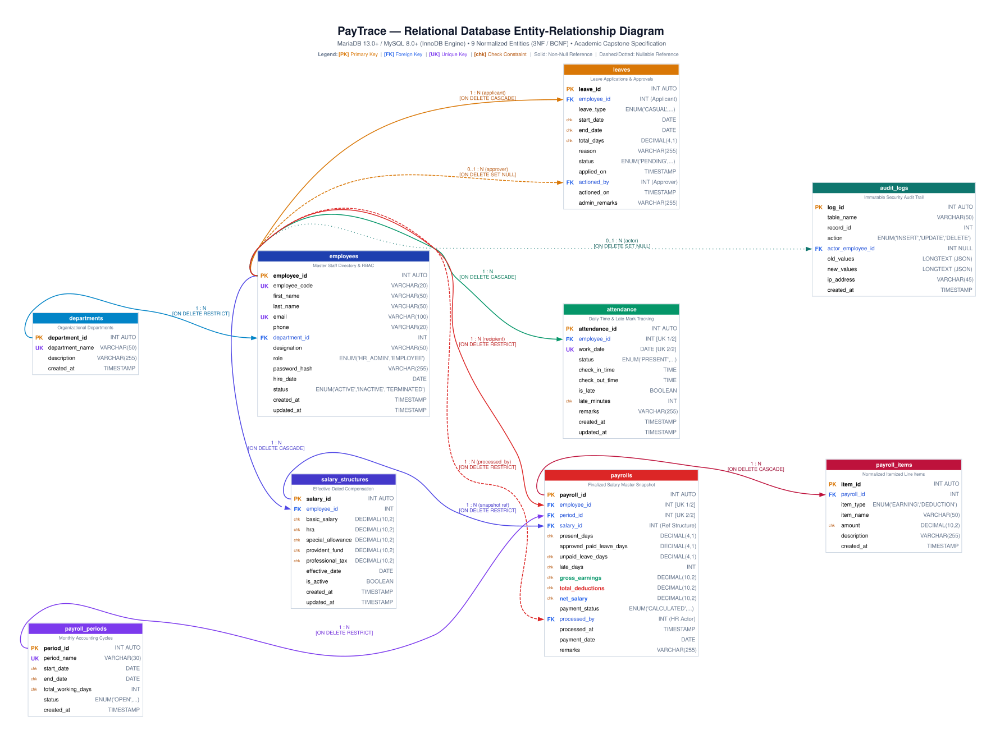
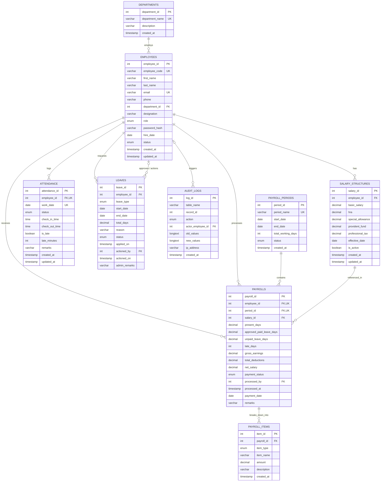

# PayTrace — Entity Relationship Diagram (Phase 1)

**Author:** Pulkit Pradhan  
**Roll Number:** 2501730036  

## Overview

The PayTrace relational database model consists of 9 normalized entities designed for transparency, strict data integrity, auditability, and role-based access control.

### Visual ER Diagram Deliverable

*High-resolution downloads:* [[Vector SVG Format]](../assets/diagrams/er-diagram.svg) • [[High-DPI PNG Format]](../assets/diagrams/er-diagram.png) • [[Graphviz DOT Source]](../assets/diagrams/er-diagram.dot) • [[Mermaid Source]](../assets/diagrams/er-diagram.mermaid)

---

### Mermaid Specification

## Relationships & Cardinalities

1. **`DEPARTMENTS` to `EMPLOYEES` (1 : 0..N)**
   - One department employs zero, one, or many employees; each employee belongs to exactly one department (`department_id NOT NULL`).
   - Referential action: `ON DELETE RESTRICT`, `ON UPDATE CASCADE`.
2. **`EMPLOYEES` to `SALARY_STRUCTURES` (1 : 0..N)**
   - One employee has zero, one, or many effective-dated salary configurations over time.
   - Referential action: `ON DELETE CASCADE`, `ON UPDATE CASCADE`.
3. **`EMPLOYEES` to `ATTENDANCE` (1 : 0..N)**
   - One employee has zero, one, or many daily attendance logs; uniqueness enforced via `UNIQUE (employee_id, work_date)`.
   - Referential action: `ON DELETE CASCADE`, `ON UPDATE CASCADE`.
4. **`EMPLOYEES` to `LEAVES` — Applicant (1 : 0..N)**
   - One employee has zero, one, or many leave records (`employee_id NOT NULL`).
   - Referential action: `ON DELETE CASCADE`, `ON UPDATE CASCADE`.
5. **`EMPLOYEES` to `LEAVES` — Approver (0..1 : 0..N)**
   - Nullable `actioned_by` references the HR/Admin employee who actioned the request (`NULL` while `PENDING`).
   - Referential action: `ON DELETE SET NULL`, `ON UPDATE CASCADE`.
6. **`EMPLOYEES` to `PAYROLLS` — Recipient & Processor (1 : 0..N)**
   - Both `employee_id` (recipient) and `processed_by` (HR/Admin actor) are `NOT NULL` references to `employees`.
   - Referential action: `ON DELETE RESTRICT`, `ON UPDATE CASCADE`.
7. **`PAYROLL_PERIODS` to `PAYROLLS` (1 : 0..N)**
   - One payroll period contains zero, one, or many employee payroll records; uniqueness enforced via `UNIQUE (employee_id, period_id)`.
   - Referential action: `ON DELETE RESTRICT`, `ON UPDATE CASCADE`.
8. **`SALARY_STRUCTURES` to `PAYROLLS` (1 : 0..N)**
   - Each payroll record references the effective `salary_id` (`NOT NULL`) used for that cycle.
   - Referential action: `ON DELETE RESTRICT`, `ON UPDATE CASCADE`.
9. **`PAYROLLS` to `PAYROLL_ITEMS` (1 : 0..N)**
   - Each payroll header links to itemized earnings and deductions in `payroll_items`.
   - Referential action: `ON DELETE CASCADE`, `ON UPDATE CASCADE`.
10. **`EMPLOYEES` to `AUDIT_LOGS` (0..1 : 0..N)**
    - Nullable `actor_employee_id` records the executing employee when available (`NULL` for system/direct SQL actions).
    - Referential action: `ON DELETE SET NULL`, `ON UPDATE CASCADE`.
