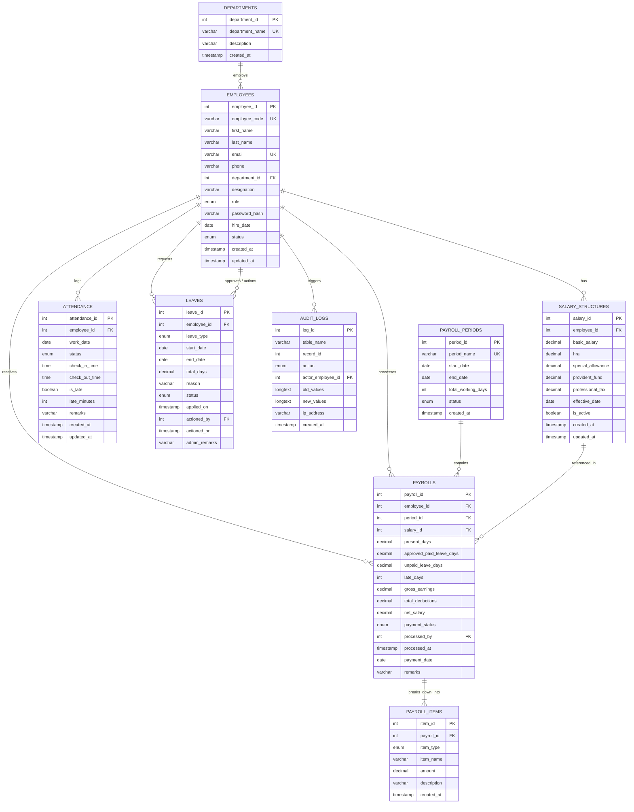

# PayTrace — Entity Relationship Diagram (Phase 1)

## Overview

The PayTrace relational database model consists of 9 normalized entities designed for transparency, strict data integrity, auditability, and role-based access control.

## Relationships & Cardinalities

1. **`DEPARTMENTS` to `EMPLOYEES` (1 : M)**
   - One department has zero, one, or many employees.
   - Each employee must belong to exactly one department (`department_id` NOT NULL).
   - Referential action: `ON DELETE RESTRICT` prevents accidental deletion of departments with active staff.

2. **`EMPLOYEES` to `SALARY_STRUCTURES` (1 : M)**
   - One employee has one or more salary structures over time (effective-dated revision history).
   - Only one record has `is_active = TRUE` for current calculations.
   - Referential action: `ON DELETE CASCADE`.

3. **`EMPLOYEES` to `ATTENDANCE` (1 : M)**
   - One employee has zero, one, or many daily attendance logs.
   - Natural uniqueness enforced on composite key `(employee_id, work_date)`.
   - Referential action: `ON DELETE CASCADE`.

4. **`EMPLOYEES` to `LEAVES` (1 : M)**
   - As Applicant: One employee submits zero, one, or many leave requests.
   - As Approver (`actioned_by`): HR/Admin employee reviews requests (`ON DELETE SET NULL`).
   - Overlap prevention enforced via trigger and application logic.

5. **`PAYROLL_PERIODS` to `PAYROLLS` (1 : M)**
   - One payroll period contains zero, one, or many processed employee payroll records.
   - Uniqueness enforced on `(employee_id, period_id)` so an employee is paid exactly once per period.
   - Referential action: `ON DELETE RESTRICT`.

6. **`PAYROLLS` to `PAYROLL_ITEMS` (1 : M)**
   - One finalized payroll record breaks down into multiple itemized earnings and deductions line items.
   - Ensures fully explainable payslip reporting.
   - Referential action: `ON DELETE CASCADE`.

7. **`EMPLOYEES` to `AUDIT_LOGS` (1 : M)**
   - Critical updates (salary revisions, payroll processing, attendance adjustments) log the actor who made the change.
   - Referential action: `ON DELETE SET NULL` ensures audit trails persist even if an employee record is deactivated or removed.
