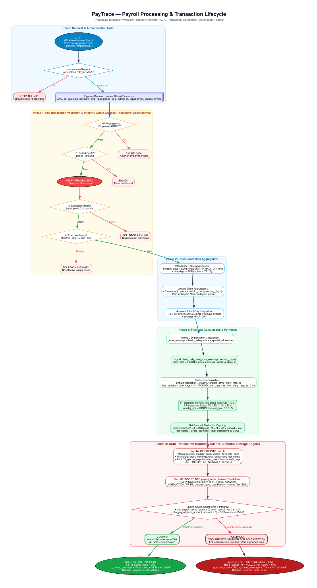

# PayTrace — Procedural Implementation Specification (Phase 2)

**Author:** Pulkit Pradhan  
**Roll Number:** 2501730036  

## 1. Overview

Phase 2 implements the finalized Phase 1 relational schema through stored SQL routines and triggers in MariaDB 13.0.2. All salary formulas, progressive tax brackets, Mon–Fri working-day leave calculations, cross-month proration, half-day deductions, attendance/leave integrity checks, transaction boundaries, and audit triggers execute inside the database engine.

---

## 2. Stored Functions (`database/functions.sql`)

### 2.1 `fn_calculate_daily_rate`
- **Signature:** `(p_monthly_gross DECIMAL(12,2), p_working_days INT) RETURNS DECIMAL(10,2)`
- **Behavior:** Computes pro-rata daily rate (`ROUND(p_monthly_gross / p_working_days, 2)`). Returns `0.00` when `p_monthly_gross` is `NULL` or negative, or when `p_working_days` is `NULL` or `<= 0`.

### 2.2 `fn_calculate_monthly_tds`
- **Signature:** `(p_annual_gross DECIMAL(12,2)) RETURNS DECIMAL(10,2)`
- **Behavior:** Simplified progressive academic TDS bracket model (not statutory tax law):
  - $\le \$300,000 \implies \$0$
  - $\$300,001 \text{ to } \$600,000 \implies 5\% \times (AG - 300,000)$
  - $\$600,001 \text{ to } \$1,200,000 \implies \$15,000 + 10\% \times (AG - 600,000)$
  - $> \$1,200,000 \implies \$75,000 + 20\% \times (AG - 1,200,000)$
  - Monthly TDS $= \text{ROUND}(\text{Annual Tax} / 12.0, 2)$.

### 2.3 `fn_count_working_days`
- **Signature:** `(p_start_date DATE, p_end_date DATE) RETURNS INT`
- **Behavior:** Counts Monday–Friday working days (`DAYOFWEEK(d) NOT IN (1, 7)`) between `p_start_date` and `p_end_date` inclusive. Returns `0` if `NULL` or `p_start_date > p_end_date`. Used consistently for leave duration validation and cross-month leave proration.

---

## 3. Database Triggers & Integrity Enforcers (`database/triggers.sql`)

| Trigger Name | Event & Table | Business Rule & Validation Logic |
| :--- | :--- | :--- |
| `trg_attendance_before_insert` | `BEFORE INSERT ON attendance` | 1. Rejects check-in/out times on `ABSENT` or `ON_LEAVE` rows. 2. Rejects `check_out_time < check_in_time`. 3. Rejects non-`ON_LEAVE` entries when an `APPROVED` leave covers `work_date`. 4. Sets `is_late = TRUE` and `late_minutes` (measured from `09:00:00`) when `check_in_time > '09:15:00'`; resets both to `FALSE`/`0` when `check_in_time IS NULL` or status is `ABSENT`/`ON_LEAVE`. |
| `trg_attendance_before_update` | `BEFORE UPDATE ON attendance` | Enforces identical validation and late-mark reset rules on updates. |
| `trg_leaves_before_insert` | `BEFORE INSERT ON leaves` | 1. Enforces `start_date <= end_date` and `total_days > 0`. 2. Rejects weekend-only ranges (`fn_count_working_days = 0`) and durations where `total_days != fn_count_working_days(start_date, end_date)`. 3. When `APPROVED`, rejects overlapping `APPROVED` leaves and conflicting non-`ON_LEAVE` `attendance` entries. |
| `trg_leaves_before_update` | `BEFORE UPDATE ON leaves` | Enforces identical date, Mon–Fri duration, overlap (`leave_id != NEW.leave_id`), and attendance conflict checks on updates. |
| `trg_salary_after_insert` | `AFTER INSERT ON salary_structures` | Logs newly created salary configurations into `audit_logs` capturing `@app_actor_id`. |
| `trg_salary_after_update` | `AFTER UPDATE ON salary_structures` | Logs before/after JSON snapshots into `audit_logs` capturing `@app_actor_id`. |
| `trg_payrolls_after_insert` | `AFTER INSERT ON payrolls` | Records finalized payroll snapshot and `NEW.processed_by` into `audit_logs`. |

---

## 4. Stored Procedures & Transaction Management (`database/procedures.sql`)

### Procedural Lifecycle Diagram

*High-resolution downloads:* [[Vector SVG Format]](../assets/diagrams/payroll-transaction-workflow.svg) • [[High-DPI PNG Format]](../assets/diagrams/payroll-transaction-workflow.png) • [[Graphviz DOT Source]](../assets/diagrams/payroll-transaction-workflow.dot) • [[Mermaid Source]](../assets/diagrams/payroll-transaction-workflow.mermaid)

### 4.1 `sp_calculate_payroll`
- **Signature:** `(IN p_employee_id, IN p_period_id, IN p_processed_by, OUT p_payroll_id, OUT p_net_salary, OUT p_status_code, OUT p_status_message)`
- **Execution Flow:**
  1. Validates `p_processed_by` is an active `HR_ADMIN` (`403` otherwise), target employee is `ACTIVE` (`404` otherwise), and payroll period exists (`404` otherwise, using strict `ONLY_FULL_GROUP_BY`-compatible queries).
  2. Opens `START TRANSACTION` prior to consistent snapshot reads and writes.
  3. Prevents duplicate processing (`409 Conflict`) using `FOR UPDATE` check + `uq_emp_payroll_period`.
  4. Selects the effective-dated salary structure (`WHERE employee_id = p_employee_id AND effective_date <= v_period_end ORDER BY effective_date DESC, salary_id DESC LIMIT 1`; returns `422` if none exists).
  5. Aggregates `PRESENT` (`1.0`), `HALF_DAY` (`0.5` present + `0.5` unpaid), unexcused `ABSENT` (excluding any date covered by an `APPROVED` leave), and late marks (`is_late = TRUE` on working statuses).
  6. Allocates cross-month `APPROVED` leaves strictly within `[v_period_start, v_period_end]` using `fn_count_working_days(GREATEST(start_date, v_period_start), LEAST(end_date, v_period_end))`.
  7. Computes gross earnings, daily rate, unpaid deduction, late penalty (`> 3` late marks at `0.5 * daily_rate`), and monthly TDS.
  8. Sequentially caps effective deductions (PF, PT, TDS, Unpaid Deduction, Late Penalty) at `gross_earnings` so `net_salary >= 0.00` and `gross_earnings - total_deductions = net_salary` always reconciles with `payroll_items`.
  9. Inserts `payrolls` (`payment_date = NULL` while `CALCULATED`) and `payroll_items`, then executes `COMMIT` (or `ROLLBACK` in `EXIT HANDLER FOR SQLEXCEPTION`).

### 4.2 `sp_process_bulk_payroll`
- **Signature:** `(IN p_period_id, IN p_processed_by, OUT p_processed_count, OUT p_error_count)`
- **Behavior:** Iterates active employees via cursor and invokes `sp_calculate_payroll` per employee. Each employee's payroll commits or rolls back independently (partial success is tracked via `p_processed_count` and `p_error_count`).

### 4.3 `sp_demonstrate_transaction_rollback`
- **Signature:** `(IN p_employee_id, IN p_period_id, IN p_processed_by, OUT p_result_status, OUT p_message)`
- **Behavior:** Demonstrates multi-step rollback safety. Inside `START TRANSACTION`, Step 1 inserts a valid probe row (`__ROLLBACK_PROBE_DEPT__`) into `departments`, and Step 2 inserts negative gross earnings (`-50000.00`) into `payrolls` violating `chk_payroll_gross`. The `SQLEXCEPTION` handler executes `ROLLBACK`, reverting both Step 1 and Step 2 with zero residual rows.
