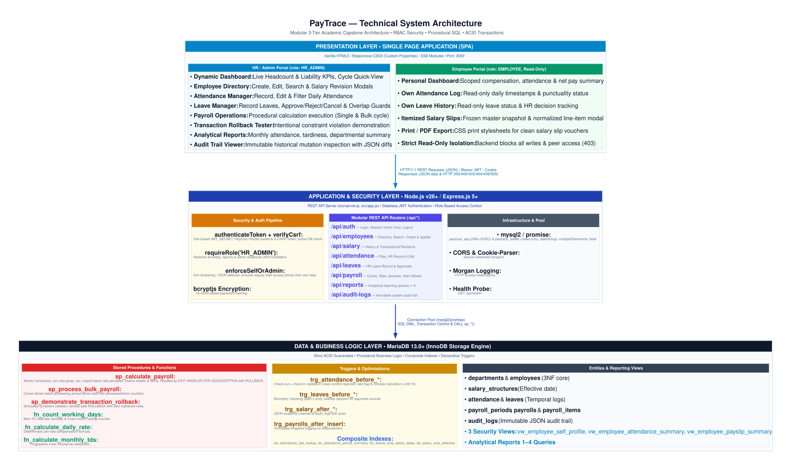
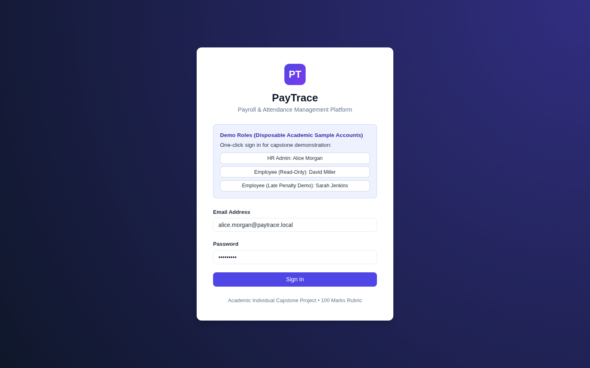
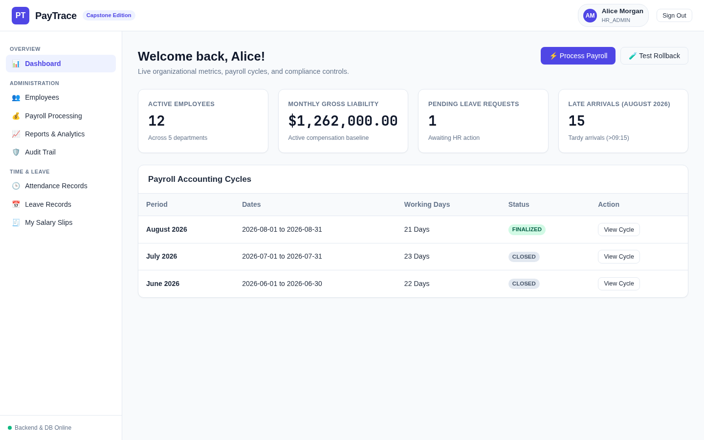
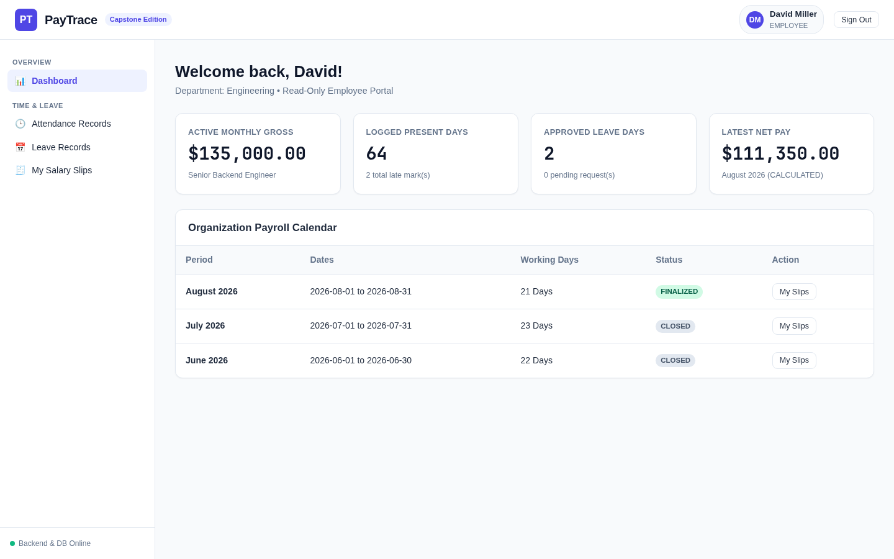
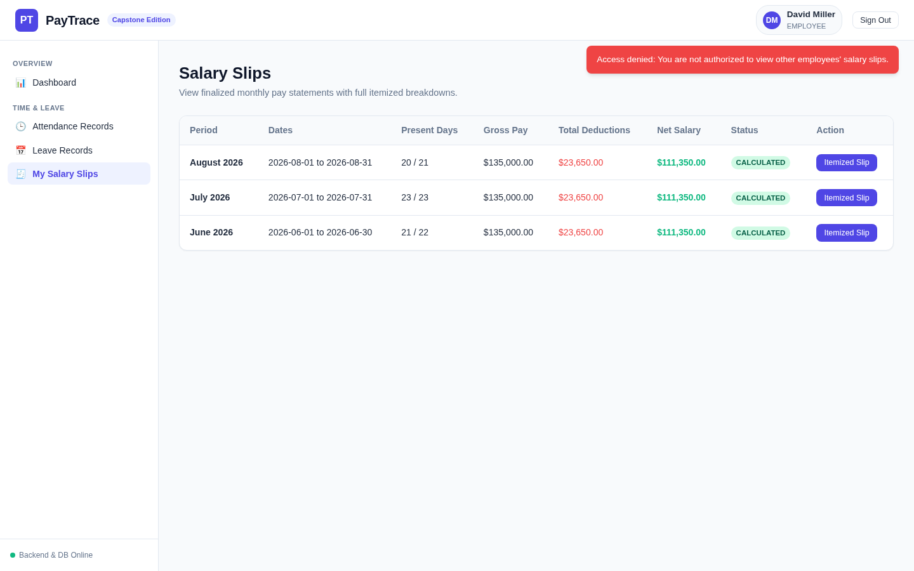

# PayTrace — Application Architecture & User Guide (Phase 5)

**Author:** Pulkit Pradhan  
**Roll Number:** 2501730036  

## 1. Purpose

This guide documents the connected full-stack PayTrace application (`src/`) operating over the frozen Phase 1 schema (`database/schema.sql`), Phase 2 procedural logic (`database/functions.sql`, `triggers.sql`, `procedures.sql`), Phase 3 indexes/reports (`database/indexes.sql`, `reports.sql`), and Phase 4 least-privilege roles & RBAC security (`database/security.sql`, `src/middleware/auth.js`).

---

## 2. Three-Tier Connected Architecture



*High-resolution diagram: [system-architecture.png](../assets/diagrams/system-architecture.png)*

1. **Tier 1 — Vanilla SPA Frontend (`src/public/index.html`, `src/public/js/app.js`, `src/public/css/style.css`):**
   - Renders role-scoped views strictly using dynamic API data (no hardcoded dashboard metrics or external font CDNs).
   - Uses `escapeHtml()` on every interpolated string to prevent DOM XSS.
   - Authenticates via `HttpOnly` JWT cookie + `csrf_token` double-submit header (`X-CSRF-Token`) through `apiFetch()`, with zero secrets stored in `localStorage`.
2. **Tier 2 — Express 5 API & Security Pipeline (`src/app.js`, `src/middleware/auth.js`, `src/routes/*.js`):**
   - Validates `JWT_SECRET` at startup (fail-closed if missing, <32 chars, or blacklisted).
   - Applies CORS allowlists, HTTP security headers, `authenticateToken`, `verifyCsrf`, `requireRole('HR_ADMIN')`, and `enforceSelfOrAdmin('employeeId')`.
   - Wraps multi-statement writes in explicit MariaDB transactions and binds `@app_actor_id` for trigger audit attribution.
3. **Tier 3 — MariaDB 13.0.2 Relational Layer (`paytrace_app` runtime account):**
   - Enforces table CHECK/UNIQUE/FK constraints, validation triggers, stored procedures, Phase 3 composite indexes, and `audit_logs` JSON snapshots.

---

## 3. Prerequisites & Local Startup

1. Configure `.env` from `.env.example` (never commit `.env`):
   - Set `DB_USER=paytrace_app`, `DB_PASSWORD`, `DB_NAME=paytrace_db`, and a unique 32+ character `JWT_SECRET`.
2. Provision the database once with administrative privileges:
   ```bash
   mysql -u root < database/setup.sql
   ```
3. Start the Express server:
   ```bash
   npm start
   ```
4. Open `http://127.0.0.1:3000`.

### Demo Evaluation Accounts
- **HR Administrator (`HR_ADMIN`):** `alice.morgan@paytrace.local` / `Admin123!`
- **Employee (`EMPLOYEE`, Strictly Read-Only):** `david.miller@paytrace.local` / `Employee123!`

---

## 4. Portal Workflows & Role Capabilities

### 4.1 Authentication Portal


- Authenticates against salted bcrypt password hashes (`POST /api/auth/login`), issues `HttpOnly` `token` and `csrf_token` cookies, and provides 1-click evaluation fill buttons for HR and Employee demos.

### 4.2 HR Administrator (`HR_ADMIN`) Portal


HR Administrators have complete management and reporting access:
- **Executive Dashboard:** Live KPI cards computed from `GET /api/reports/dashboard-summary` (12 active employees, `$1,262,000.00` monthly gross liability, pending leave count, active period tardy arrivals, and payroll cycle table).
- **Staff Directory, Edit & Compensation History (`POST/PUT /api/employees`, `GET/POST /api/salary/:employeeId`):** Filterable roster (`04-employee-roster.png`), employee onboarding/editing modals, and effective-dated salary structure revision modal (`12-salary-management.png`).
- **Attendance Records (`POST/PUT /api/attendance`):** HR-managed attendance recording and editing (`05-attendance-management.png`) with database trigger validation for time order and exact `09:15:00` grace-period punctuality.
- **Leave Records & Overlap-Safe Approvals (`POST /api/leaves`, `PUT /api/leaves/:leaveId/status`):** Record leaves (`total_days` calculated strictly server-side over Mon–Fri) and approve, reject, or cancel requests (`06-leave-workflow.png`).
- **Payroll Processing & Atomic Rollback Verification (`POST /api/payroll/process`, `POST /api/payroll/test-rollback`):** Run single or bulk payroll across dynamically loaded cycles (`07-payroll-processing.png`), inspect itemized slips (`08-itemized-salary-slip.png`), and trigger the 2-step `sp_demonstrate_transaction_rollback` demo (`13-rollback-demo.png`).
- **Phase 3 Reports & Security Audit Trail (`GET /api/reports/*`, `GET /api/audit-logs`):** View Monthly Attendance Summary (`09-monthly-attendance-report.png`), Departmental Breakdown, Late-Marks Report (`10-late-marks-report.png`), and immutable trigger-captured audit snapshots (`14-audit-trail.png`).

### 4.3 Employee Self-Service (`EMPLOYEE`) Portal — Strictly Read-Only


Per Phase 4 & Phase 5 academic requirements, employees are strictly **read-only** over all organizational business records:
- Navigation hides all administrative tabs (`Employees`, `Payroll Processing`, `Reports & Analytics`, `Audit Trail`) and omits all write buttons (`+ Add Employee`, `+ Record Attendance`, `+ Record Leave`, `Approve/Reject`, `Process Payroll`).
- Dashboard (`GET /api/auth/dashboard`) displays only the authenticated employee's active compensation breakdown, recent attendance summary, leave history, and recent salary cycles.
- **IDOR / Horizontal Protection:** Requesting another employee's slip or records via API returns `403 Forbidden` (`11-access-denied-behavior.png`).



---

## 5. Verification

Run all 32 automated checks (SQL, Unit, HTTP, and Chromium CDP Browser E2E):
```bash
npm run test:all
```
