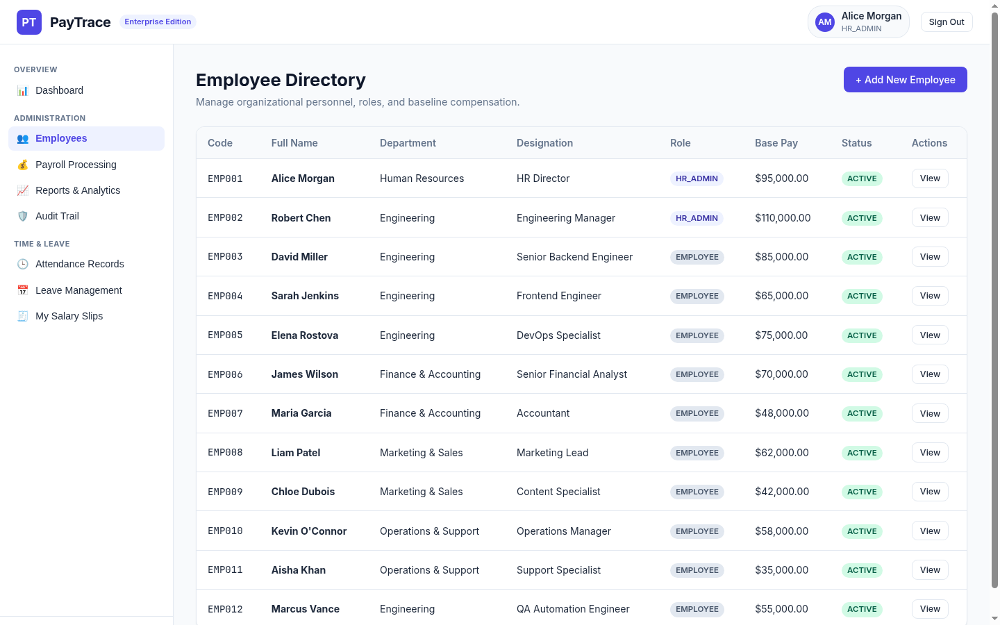
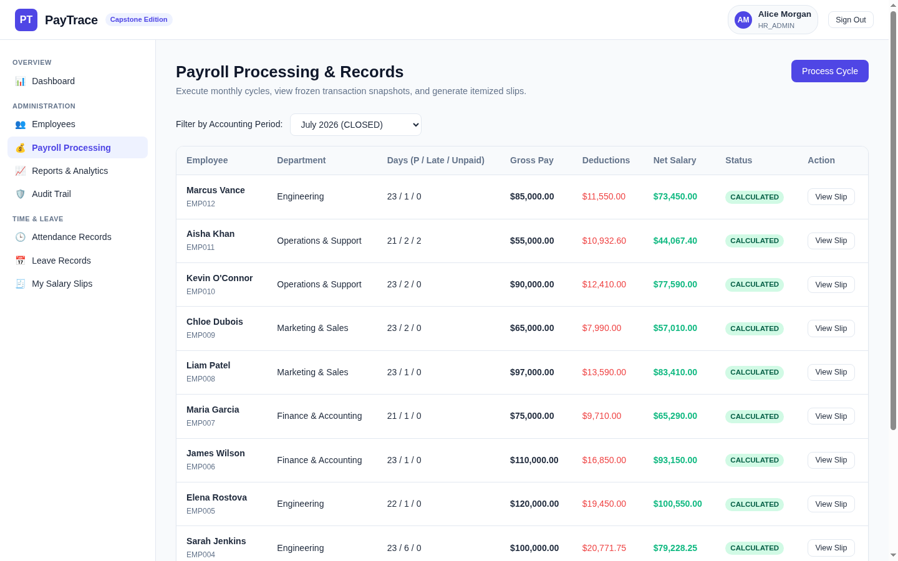
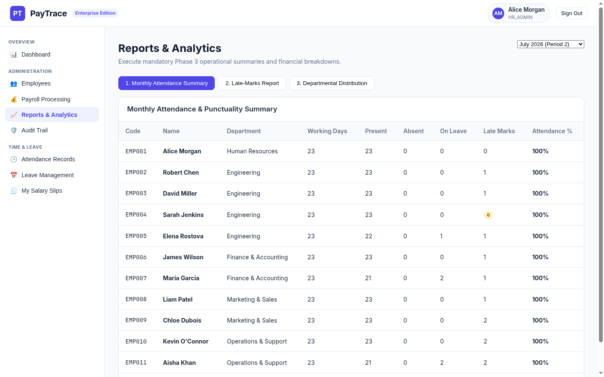
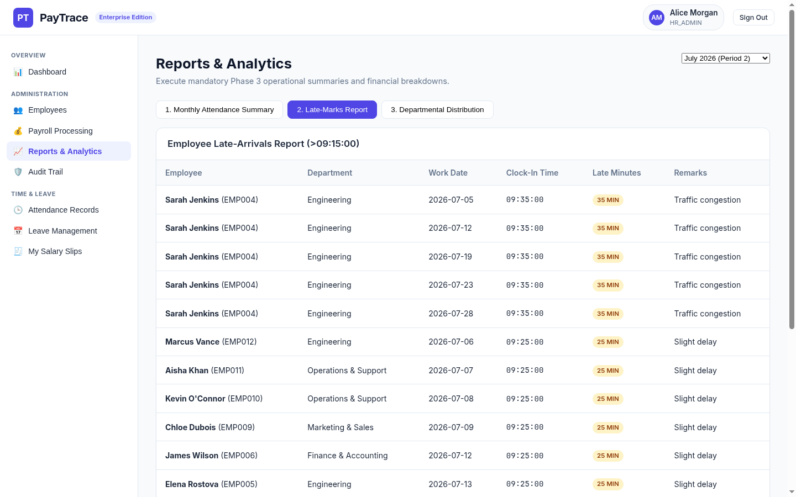
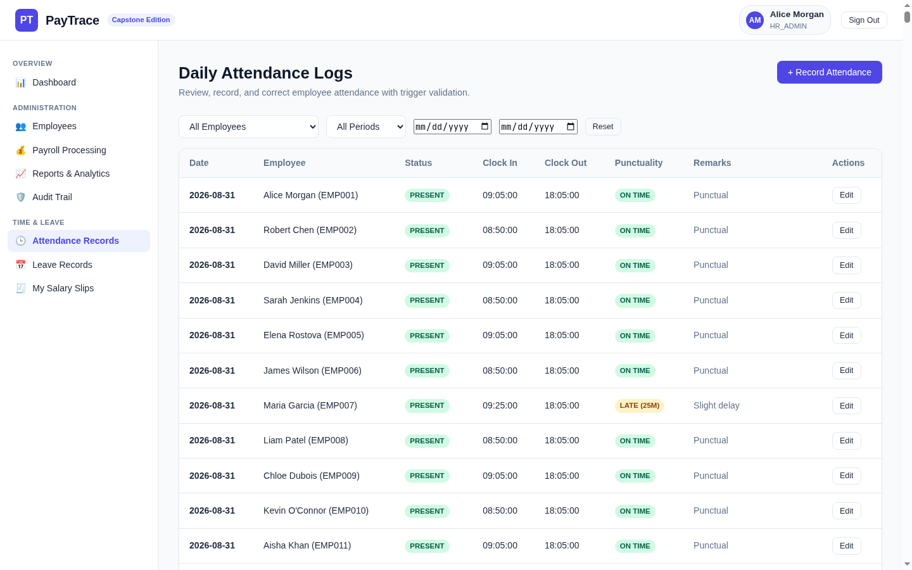
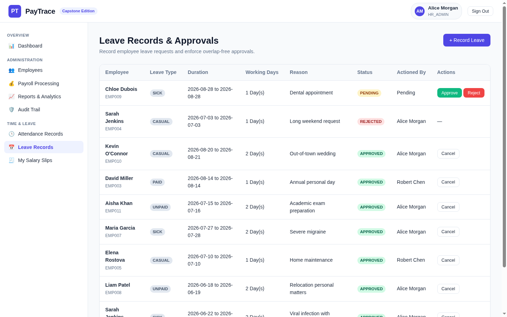

# PayTrace — Application User Guide (Phase 5)

**Author:** Pulkit Pradhan  
**Roll Number:** 2501730036  

## 1. Introduction

**PayTrace** is a full-stack, relational database-driven Payroll & Attendance Management System designed to ensure explainable salaries, audit transparency, strict role-based access control, and transaction safety.

---

## 2. System Architecture & Prerequisites

- **Backend:** Node.js v26+, Express.js 5+
- **Database:** MariaDB 13.0+ / MySQL 8.0+ (InnoDB Storage Engine)
- **Frontend:** Responsive HTML5, CSS3 Custom Properties, Vanilla JavaScript (Single Page Architecture)
- **Authentication:** HTTP-only cookies & Authorization Bearer JWT tokens, salted Bcrypt credentials.

### System Architecture Diagram


*High-resolution downloads:* [[Vector SVG Format]](../assets/diagrams/system-architecture.svg) • [[High-DPI PNG Format (3927 × 3218 px)]](../assets/diagrams/system-architecture.png) • [[Graphviz DOT Source]](../assets/diagrams/system-architecture.dot) • [[Mermaid Source]](../assets/diagrams/system-architecture.mermaid)

---

## 3. Getting Started

### 3.1 Environment Configuration
Create a `.env` file from the provided `.env.example`:
```ini
PORT=3000
NODE_ENV=development
DB_HOST=127.0.0.1
DB_PORT=3306
DB_USER=root
DB_PASSWORD=
DB_NAME=paytrace_db
JWT_SECRET=your_secure_random_jwt_secret_key_here
```

Generate a cryptographically strong 256-bit JWT signing secret:
```bash
node -e "console.log(require('crypto').randomBytes(32).toString('hex'))"
```

### 3.2 Database Initialization
Run the master setup script to provision the schema, stored functions, triggers, procedures, and seed data:
```bash
mariadb -u root -h 127.0.0.1 < database/setup.sql
```

### 3.3 Starting the Server
```bash
npm install
npm start
```
The application will be live at `http://localhost:3000`.

---

## 4. Role Navigation Guide

### 4.1 HR / Admin Portal
Login using: `alice.morgan@paytrace.local` / `Admin123!`

1. **Dashboard:**
   - Displays real-time aggregate metrics: active employees count (12), standard monthly gross liability ($1.26M), pending leave count (1), and monthly tardy arrivals (19).
   - Provides quick-action triggers to execute payroll cycles and test transaction rollback.

   

2. **Employee Directory:**
   - Full organizational roster across 5 departments.
   - Click **"+ Add New Employee"** to register a new employee along with their initial baseline compensation structure.

   

3. **Payroll Processing:**
   - Filter payroll records by accounting cycle (June 2026, July 2026, August 2026).
   - Execute single-employee or bulk cycle processing via `sp_process_bulk_payroll`.
   - Click **"View Slip"** to inspect the frozen historical snapshot and itemized line-item breakdown.

   

4. **Reports & Analytics:**
   - **Monthly Attendance Summary:** Aggregates working days, days present, absences, approved leaves, and late marks.
   - **Late-Marks Report:** Identifies employees arriving past shift grace threshold (>09:15) with exact minutes late.
   - **Departmental Distribution:** Visualizes gross liabilities, deductions, and net disbursed funds per department.

   
   

5. **Audit Trail:**
   - Displays immutable security audit logs for sensitive modifications, with actor identity, action type (`INSERT`/`UPDATE`), and JSON before/after state captures.

---

### 4.2 Employee Self-Service Portal
Login using: `david.miller@paytrace.local` / `Employee123!` or `sarah.jenkins@paytrace.local` / `Employee123!`


1. **Personal Dashboard:**
   - Displays personal compensation profile, department, and quick clock-in banner.

   

2. **Daily Attendance:**
   - Shows personal attendance calendar, check-in and check-out timestamps, and punctuality status.
   - Click **"Check In / Out Now"** to record daily presence with automatic late evaluation.

   

3. **Leave Management:**
   - Submit leave applications specifying leave type, dates, and justification.
   - Automatic calculation of requested days with client and database boundary checks (`start_date <= end_date`).

   

4. **My Salary Slips:**
   - Access finalized monthly payslips.
   - Open itemized salary slip modal featuring detailed earnings, statutory deductions, late mark penalties, and progressive TDS tax.
   - Click **"Print Slip"** for clean print/PDF export.

   

5. **Data Isolation Security:**
   - Employees are prevented from viewing or modifying other staff records. Any attempted URL tampering (e.g. requesting another employee's payslip or attendance) terminates with `403 Forbidden`.

   
