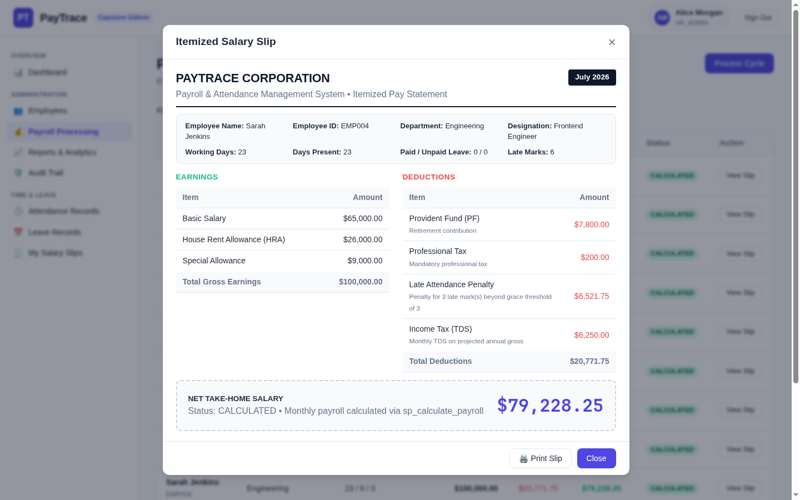
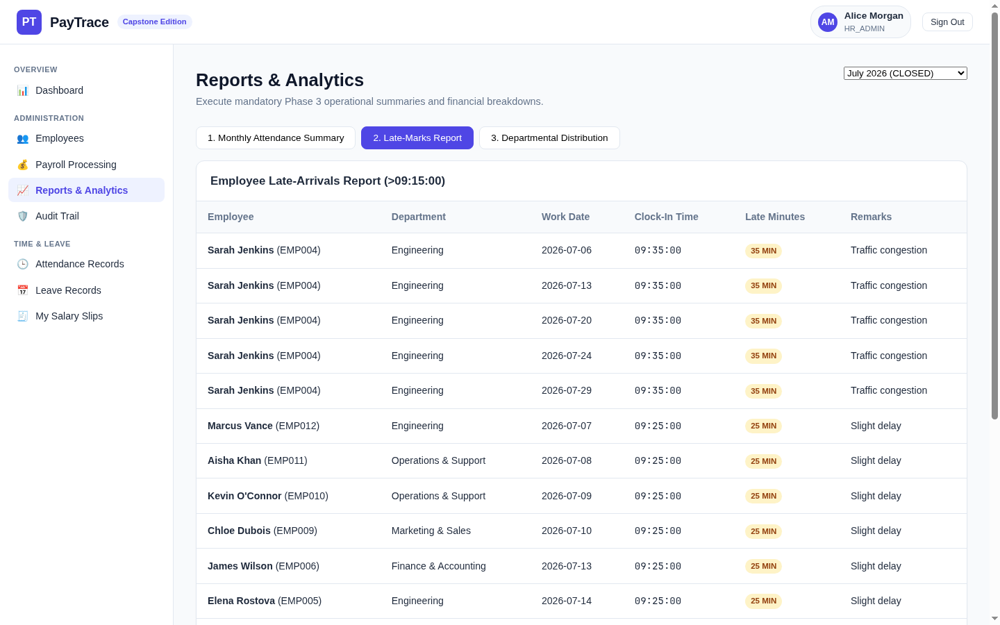
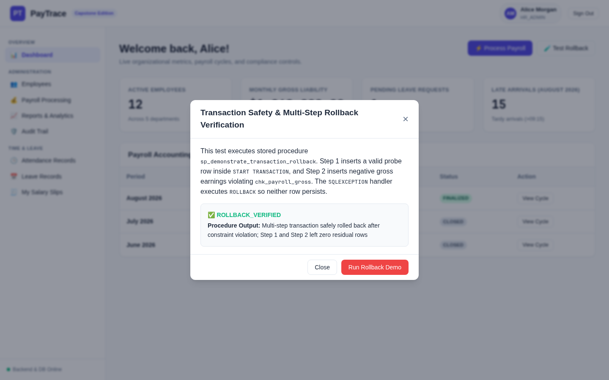
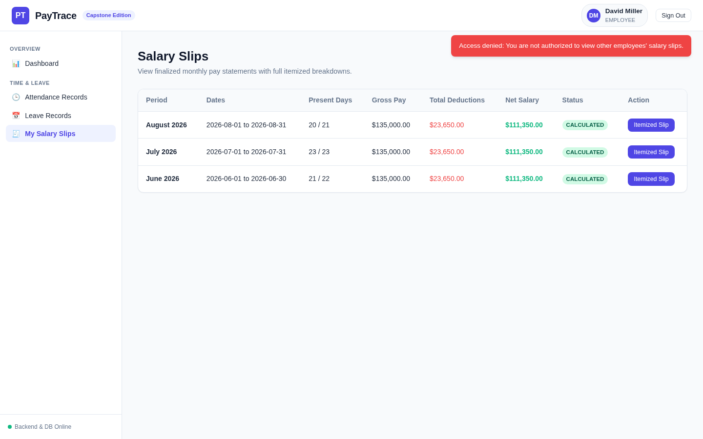

# PayTrace — Live Capstone Demonstration Script (Phase 5)

**Author:** Pulkit Pradhan  
**Roll Number:** 2501730036  
**Target Environment:** Fresh MariaDB `paytrace_db` + Running Express 5 UI (`http://127.0.0.1:3000`)

---

## Step 1: Schema & Relational Integrity Proof (Phase 1)

1. Open [`docs/assets/diagrams/er-diagram.svg`](../assets/diagrams/er-diagram.svg) and verify the 9-table 3NF model (`departments`, `employees`, `salary_structures`, `attendance`, `leaves`, `payroll_periods`, `payrolls`, `payroll_items`, `audit_logs`).
2. Highlight immutable historical design: `payrolls` stores both `salary_id` (the effective structure selected on `effective_date <= period.end_date`) and itemized snapshots in `payroll_items`.
3. Optionally verify schema immutability checksum: `sha256sum database/schema.sql`.

---

## Step 2: Procedural Logic, Triggers & Sample Dataset Proof (Phase 2)

Diagram reference: [`docs/assets/diagrams/payroll-transaction-workflow.svg`](../assets/diagrams/payroll-transaction-workflow.svg)

1. Confirm 3-month Mon–Fri dataset counts directly in MariaDB:
   - June 2026 (`22` working days), July 2026 (`23` working days), August 2026 (`21` working days)
   - `12` employees, `792` attendance records, `10` leaves, `36` payrolls, `221` payroll line-items.
2. Demonstrate trigger validation in SQL:
   - `09:15:00` check-in is `is_late = 0`, whereas `09:15:01` sets `is_late = 1, late_minutes = 15`.
   - `leaves` overlapping an `APPROVED` leave (on `INSERT` or `UPDATE`) aborts with `SQLSTATE '45000'`.

---

## Step 3: Mandatory Phase 3 Reports & Query Optimization

1. Sign in as **HR Admin (`alice.morgan@paytrace.local`)** -> **Payroll Processing** -> **July 2026** -> click **View Slip** for **Sarah Jenkins (`EMP004`)**.
   
   - Show exact itemized reconciliation: Gross `$100,000.00`, PF `$7,800.00`, PT `$200.00`, Late Penalty `$6,521.75` (`3` penalty half-days over `23` working days), TDS `$6,250.00`, Net `$79,228.25`.
   - Equivalent API check: `GET /api/payroll/slip/16`.
2. Open **Reports & Analytics** (`July 2026`):
   - **Report 1 — Monthly Attendance Summary:** `12` employees, `23` working days, accurate `HALF_DAY` (0.5) handling and attendance percentages.
   - **Report 3 — Late-Marks Report:** `19` late arrivals in July (`6` for `EMP004`), backed by `idx_attendance_late_lookup(is_late, work_date)`.
   
3. Reference reproducible `EXPLAIN` & `ANALYZE FORMAT=JSON` results in [`docs/phase-3/query-optimization.md`](../phase-3/query-optimization.md): indexed range scan reduces optimizer cost by `93.5%` on the 792-row dataset and `99.3%` (`11.9x` faster median query latency) at 50,000 rows.

---

## Step 4: Security, RBAC, CSRF, Transaction Rollback & Automated Suite (Phase 4)

1. From the HR Dashboard, click **Test Rollback** (`POST /api/payroll/test-rollback` -> `sp_demonstrate_transaction_rollback`):
   
   - Confirm `ROLLBACK_VERIFIED` modal and verify zero residual rows from the multi-step probe (`__ROLLBACK_PROBE_DEPT__` + negative payroll insert).
2. Switch to **Employees** -> open **History / Revise** salary (`12-salary-management.png`), submit a salary revision, then inspect **Audit Trail** (`14-audit-trail.png`) to show `@app_actor_id` attribution (`Alice Morgan`) on both the old structure deactivation (`UPDATE`) and new structure activation (`INSERT`).
3. Log out and sign in as **David Miller (`EMP003`, `EMPLOYEE`)** (`03-employee-dashboard.png`):
   - Show that admin nav items and write controls are absent (Employee is strictly read-only).
   - Attempt cross-employee slip read `GET /api/payroll/slip/16` (from console or curl) to demonstrate `403 Forbidden`:
   
4. Run the full automated verification suite from terminal:
   ```bash
   npm run test:all
   ```
   Confirm `21 / 21 PASSED` (SQL/Unit/HTTP) and `11 / 11 PASSED` (Chromium Browser E2E).
