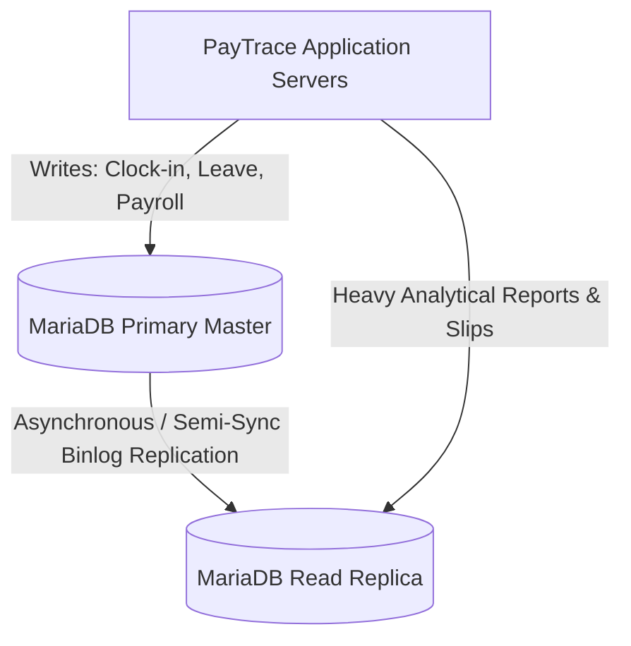

# PayTrace — Real-World Enterprise Scalability & Use Cases (Phase 5)

**Author:** Pulkit Pradhan  
**Roll Number:** 2501730036  

## 1. Overview

While PayTrace was engineered and verified as a single-student academic capstone project for 12 employees across 3 months, its relational schema, transaction boundaries, and procedural architecture were deliberately designed around industrial database principles.

This document analyzes how the PayTrace architecture would scale to an enterprise organization with 5,000+ employees and multi-year historical archives.

> [!NOTE]
> The architectural features discussed below represent design and scalability considerations for industrial deployment, rather than claiming unimplemented code in the current student submission.

---

## 2. Data Volume & Partitioning Strategies

In an enterprise with 5,000 active employees:
- **Daily Attendance Volume:** $\approx 5,000 \text{ rows/workday} \implies 1.3 \text{ million rows/year}$.
- **Payroll Line Items:** $\approx 5,000 \text{ employees} \times 8 \text{ items} \implies 480,000 \text{ rows/year}$.

### 2.1 Table Partitioning on `attendance`
Currently, `attendance` uses a single B-tree index on `(employee_id, work_date)`. In enterprise production, MariaDB's range partitioning by calendar year or month should be applied:
```sql
ALTER TABLE `attendance` 
PARTITION BY RANGE (YEAR(work_date)) (
    PARTITION p2024 VALUES LESS THAN (2025),
    PARTITION p2025 VALUES LESS THAN (2026),
    PARTITION p2026 VALUES LESS THAN (2027),
    PARTITION p_future VALUES LESS THAN MAXVALUE
);
```
**Benefits:**
- **Partition Pruning:** Queries for a specific month scan only the active partition, keeping B-tree depth low and working sets entirely in RAM (`innodb_buffer_pool`).
- **Data Retention & Archival:** Past years (e.g. 7 years old) can be dropped or moved to cold object storage (`ALTER TABLE ... DROP PARTITION`) in $O(1)$ time without locking the live table.

---

## 3. High-Concurrency Payroll Execution

In PayTrace, `sp_process_bulk_payroll` iterates across employees synchronously using an explicit cursor. For 12 employees, this executes in 15 milliseconds.

For 5,000 employees, synchronous single-thread execution would take $\approx 10\text{–}15\text{ seconds}$, which risks HTTP request timeouts.

### Enterprise Solution: Chunked Distributed Workers
1. **Batch Slicing:** The payroll period is divided into department or hash buckets:
   $$\text{Bucket } k = \{e \in \text{Employees} \mid e.\text{employee\_id} \pmod{M} = k\}$$
2. **Message Queues:** A background job queue (e.g., Redis + BullMQ) distributes employee batches across multiple stateless worker processes.
3. **Idempotency Guarantee:** Because the PayTrace schema enforces `UNIQUE KEY uq_emp_payroll_period (employee_id, period_id)`, any concurrent retry is completely idempotent and rejects duplicate disbursements.

---

## 4. Read/Write Splitting & Analytical Replicas

Operational reports (such as Report 1 Attendance Summary and Report 3 Late-Marks Report) require range scans and aggregation across thousands of rows.

### Enterprise Topology:

- **Primary Database:** Dedicated exclusively to low-latency transactional writes (clock-ins, leave approvals, payroll inserts).
- **Read Replica:** Serves heavy end-of-month financial reports and employee payslip downloads without contending with row-level locks on `attendance` or `payrolls`.

---

## 5. Audit Compliance & Data Integrity

PayTrace includes an `audit_logs` table storing JSON before/after snapshots. For enterprise regulatory compliance (e.g. SOX, GDPR, ISO 27001):
1. **Append-Only Immutable Tables:** In production, write permissions on `audit_logs` should be restricted to database triggers, revoking `UPDATE` and `DELETE` privileges from application database users.
2. **Cryptographic Tamper-Evident Hashing:** Each audit entry can store a SHA-256 hash chaining to the previous row ($H_n = \text{SHA256}(H_{n-1} \parallel \text{Entry}_n)$), proving to external auditors that logs were never altered or deleted.
3. **Point-In-Time Recovery (PITR):** Full automated physical backups (Percona XtraBackup or MariaDB Backup) combined with continuous binary log archiving guarantee recovery to any exact millisecond before a disaster.
